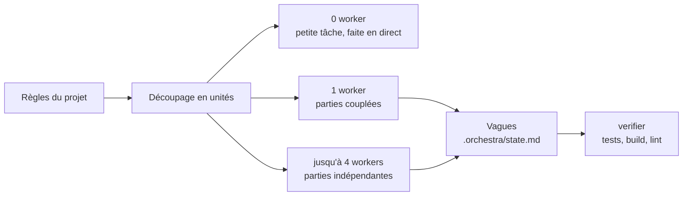

# claude-code-orchestra

[English](README.md) | **Français**

Un orchestrateur pour les grosses tâches de code dans **Claude Code** et **Cursor**.

Donnez une tâche volumineuse à votre agent et il cesse de tout faire seul : il découpe le travail en unités, décide combien de workers lancer (aucun, un, ou jusqu'à 4 en parallèle), remet à chacun une consigne courte, et vérifie le résultat combiné avant de vous le rendre.

> Statut : v0.2 (non publiée, voir [CHANGELOG.md](CHANGELOG.md)). Cela fonctionne, c'est affirmé dans ses choix, et ce n'est pas encore réglé sur beaucoup de projets réels. Retours et PR bienvenus.



## Contenu du dépôt

| Chemin | Rôle |
|---|---|
| `claude/skills/orchestrate/` | Le skill d'orchestration : découper, dimensionner, distribuer, suivre, vérifier |
| `claude/agents/` | 3 sous-agents : `explorer` (lecture seule, modèle économique), `implementer` (une unité à la fois), `verifier` (lance les contrôles, ne corrige jamais) |
| `claude/CLAUDE.snippet.md` | Règle optionnelle qui déclenche l'orchestration automatiquement sur les grosses tâches |
| `cursor/` | La même règle et des copies en lecture seule des agents pour Cursor |
| `examples/project-skills/` | Deux modèles de règles par projet : les vagues par package, et les commandes de vérification |
| `lean-ctx/` | Optionnel, recommandé : installation de [lean-ctx](https://github.com/yvgude/lean-ctx), qui compresse les lectures et la sortie du shell, plus un shell verrouillé pour que les workers lancent les commandes sûres sans confirmation et se voient refuser le reste |
| `tools/usage-report.py` | Rapport d'usage des tokens et des modèles à partir de vos transcriptions locales : tokens par modèle, taux de cache, projets et outils les plus coûteux, suggestions |
| `tools/orchestra-validate.py` | Validateur de `.orchestra/state.md` (en-tête, tableau des unités, sections, 4 workers actifs au maximum) |
| `hooks/` | Hooks Claude Code optionnels qui font respecter les règles des workers : contrôle du format des rapports et garde de périmètre des fichiers. Voir [hooks/README.md](hooks/README.md) |
| `tests/` | Suite `unittest` de la bibliothèque standard pour l'installeur, la fusion des permissions, le rapport d'usage et le validateur d'état |
| `.github/workflows/ci.yml` | CI : tests sur Linux, macOS et Windows, plus shellcheck et PSScriptAnalyzer |
| `docs/token-and-model-optimization.md` | Les 7 leviers de ce dépôt pour dépenser moins de tokens et utiliser le bon modèle pour chaque tâche |

## Ce que fait le skill

- **Reprise** : si `.orchestra/state.md` existe, il le lit en premier et continue à partir de la vague inachevée au lieu de replanifier.
- **Garde-fou de coût** : avant chaque vague, il estime la dépense en tokens et vous demande d'abord votre accord quand la vague est importante.
- **Véhicules** : sous-agents, sessions séparées, ou Agent Teams (expérimental, sur option, demande avant de l'activer). Dans l'application de bureau Claude, les workers qui écrivent en parallèle démarrent comme des sessions visibles dans la barre latérale.
- **Isolation** : les worktrees natifs de Claude Code (`claude --worktree`, `EnterWorktree`, ou `isolation: "worktree"`).
- **État** : `.orchestra/state.md` contient une ligne `Wave:` (par exemple `2/3`).

## Comment il décide

1. **0 worker** quand la tâche tient en environ 15 appels d'outils. Déléguer une petite tâche coûte plus cher que la faire.
2. **1 worker** quand les parties dépendent les unes des autres ou touchent les mêmes fichiers.
3. **N workers (4 au maximum)** seulement pour des parties vraiment indépendantes : aucun fichier partagé, aucune dépendance au résultat d'une autre partie. Les parties dépendantes attendent la vague suivante.

La principale leçon à ce jour : le gain ne vient pas du parallélisme, il vient de savoir quand **ne pas** paralléliser.

## Garder un contexte réduit

- Chaque worker démarre à froid avec une consigne de quelques lignes : l'objectif, les fichiers qu'il peut toucher, ce que veut dire « terminé ».
- Chaque worker rend un rapport de 10 lignes maximum, dans un format fixe.
- L'avancement vit dans `.orchestra/state.md` (exclu de git), donc rien n'est perdu quand la conversation est compactée.
- Les workers qui écrivent ne partagent jamais de fichiers : un worktree git par worker, ou un dépôt par worker dans les espaces de travail multi-dépôts.

## Dépenser moins de tokens

Chaque tâche va au modèle le moins cher capable de la faire : les recherches sur Haiku (`explorer`), les contrôles sur Sonnet (`verifier`), la conception et les contrats sur le modèle le plus fort. En plus, [lean-ctx](lean-ctx/README.md) compresse les lectures de fichiers et la sortie des commandes, et le rapport montre où partent réellement vos tokens :

```bash
python3 tools/usage-report.py            # tokens par modèle, taux de cache, projets et outils les plus coûteux
```

Tous les leviers, et comment lire le rapport : [docs/token-and-model-optimization.md](docs/token-and-model-optimization.md) (en anglais).

## Tests et CI

Les tests n'utilisent que la bibliothèque standard de Python :

```bash
python3 -m unittest discover -s tests
python3 tools/orchestra-validate.py .orchestra/state.md   # valider un fichier d'état
```

La CI (`.github/workflows/ci.yml`) lance la suite sur Ubuntu, macOS et Windows, plus `shellcheck` sur les scripts shell et PSScriptAnalyzer sur les scripts PowerShell. Voir [CONTRIBUTING.md](CONTRIBUTING.md) (en anglais).

## Hooks

Optionnels, bibliothèque standard de Python 3 uniquement, dans [hooks/](hooks/README.md) :

- `subagent-report-check.py` (SubagentStop) : bloque un worker dont le rapport final n'a pas un champ obligatoire ou dépasse 10 lignes.
- `scope-guard.py` (PreToolUse, `Edit|Write`) : refuse les modifications en dehors des chemins listés dans `ORCHESTRA_SCOPE`.

L'extrait de settings.json et le comportement exact sont dans [hooks/README.md](hooks/README.md).

## À venir

- Empaquetage en plugin (`.claude-plugin`), en cours. Pas encore de commande d'installation.
- `benchmarks/` : les fixtures et les contrôles des tâches sont dans le dépôt ; le harnais existe sur une branche, sans résultat pour l'instant.

## Installation

Les deux installeurs placent les fichiers dans votre dossier de configuration Claude Code (`~/.claude`, ou `$CLAUDE_CONFIG_DIR` si vous l'avez défini) et dans `~/.cursor` si Cursor est installé. Les fichiers existants sont d'abord sauvegardés en `<fichier>.bak-<horodatage>`, et relancer l'installeur ne change rien de ce qui est déjà à jour. Essayez toujours d'abord à blanc.

### Linux et macOS

```bash
git clone https://github.com/NefziSofien/claude-code-orchestra.git
cd claude-code-orchestra
./install.sh --dry-run
./install.sh
```

Les fichiers sont **liés par des liens symboliques** par défaut, donc un `git pull` vous maintient à jour. Options : `--copy`, `--no-cursor`, `--with-claude-md` (ajoute la règle de déclenchement automatique), `--dry-run`. Fonctionne avec le bash 3.2 livré avec macOS.

### Windows (PowerShell)

```powershell
git clone https://github.com/NefziSofien/claude-code-orchestra.git
cd claude-code-orchestra
powershell -ExecutionPolicy Bypass -File .\install.ps1 -DryRun
powershell -ExecutionPolicy Bypass -File .\install.ps1
```

Les fichiers sont **copiés** par défaut, car Windows n'autorise les liens symboliques qu'avec le mode développeur activé ou depuis un shell administrateur ; relancez l'installeur après un `git pull` pour mettre à jour. Options : `-Link` (lien symbolique, repli sur la copie si Windows refuse), `-NoCursor`, `-WithClaudeMd`, `-DryRun`. Fonctionne avec Windows PowerShell 5.1 et PowerShell 7. Depuis Git Bash ou WSL, vous pouvez aussi utiliser `install.sh`.

### Optionnel : lean-ctx

Installez lean-ctx, puis lancez `./lean-ctx/setup.sh` (ou `.\lean-ctx\setup.ps1` sous Windows) avec `--dry-run` / `-DryRun` d'abord. Détails dans [lean-ctx/README.md](lean-ctx/README.md) (en anglais).

### Ensuite

Redémarrez Claude Code / Cursor, puis tapez `/orchestrate <tâche>` ou, avec la règle de déclenchement automatique, donnez simplement une grosse tâche.

## L'adapter à votre projet

Le skill global est générique. Les vrais gains viennent de deux petits skills de projet dans `<projet>/.claude/skills/` :

- `orchestrate-<projet>` : ce qu'est une unité dans votre dépôt, quelles parties passent en premier (par exemple le backend avant les clients quand un contrat d'API change), ce que doit contenir chaque consigne.
- `verify-package` (ou tout `verify-*`) : les contrôles rapides et complets exacts par package, et les commandes qui ne doivent jamais être lancées comme « contrôle ».

Partez de `examples/project-skills/`, remplacez les commandes par les vôtres, et lancez chacune une fois pour vérifier qu'elle fonctionne. Le skill global les charge automatiquement.

## Cursor

Cursor lit nativement `~/.claude/skills` et `~/.claude/agents`. Deux différences sont gérées par le dossier `cursor/` :

- Cursor ignore le champ `tools` des agents et les alias de modèles Claude, donc `explorer` et `verifier` ont des copies pour Cursor avec `readonly: true` et `model: inherit`.
- Cursor ne lit pas `CLAUDE.md`. La règle va dans `~/.cursor/rules/orchestrate.mdc` ; pour le contexte du projet, liez `AGENTS.md` à `CLAUDE.md` (`ln -s CLAUDE.md AGENTS.md`).

Les règles de niveau utilisateur dans `~/.cursor/rules/` ne sont pas documentées par Cursor. Si la règle ne semble pas s'appliquer, collez-la dans Customize → Rules.

## Sécurité par défaut

- L'orchestrateur montre son plan avant de distribuer le travail et demande avant toute action irréversible (push, déploiement, migration, suppression).
- Les workers ne font jamais de commit ni de push sauf si la consigne le dit ; les branches de worktree ne sont fusionnées qu'avec votre accord.
- Le `verifier` ne modifie jamais de fichier, et l'exemple `verify-package` liste les commandes qui ne doivent jamais servir de contrôle (e2e, migrations, déploiements).

## Licence

MIT
