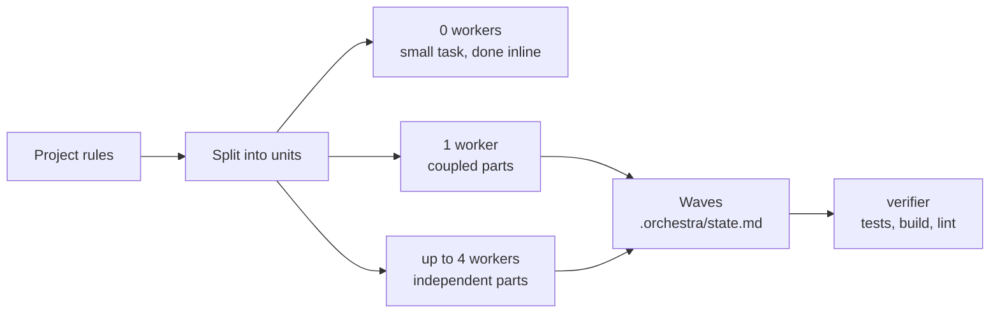

# claude-code-orchestra

An orchestrator for big coding tasks in **Claude Code** and **Cursor**.

Give your agent a large task and it stops doing everything alone: it splits the work into units, decides how many workers to run (none, one, or up to 4 in parallel), hands each a short brief, and verifies the combined result before handing back.

> Status: v0. It works, it is opinionated, and it has not been tuned on many real projects yet. Feedback and PRs welcome.



## What's inside

| Path | What it is |
|---|---|
| `claude/skills/orchestrate/` | The orchestration skill: decompose, size, dispatch, track, verify |
| `claude/agents/` | 3 subagents: `explorer` (read-only, cheap model), `implementer` (one unit at a time), `verifier` (runs checks, never fixes) |
| `claude/CLAUDE.snippet.md` | Optional rule that triggers orchestration automatically on big tasks |
| `cursor/` | The same rule and read-only agent copies for Cursor |
| `examples/project-skills/` | Two templates for per-project rules: waves per package, and verification commands |
| `lean-ctx/` | Optional, recommended: [lean-ctx](https://github.com/yvgude/lean-ctx) setup that compresses reads and shell output, plus a locked-down shell so workers run safe commands without prompts and are refused the rest |
| `tools/usage-report.py` | Token and model usage report from your local transcripts: tokens per model, cache hit rate, costliest projects and tools, suggestions |
| `docs/token-and-model-optimization.md` | The 7 levers this repo uses to spend fewer tokens and the right model per job |

## How it decides

1. **0 workers** when the task fits in roughly 15 tool calls. Delegating a small task costs more than doing it.
2. **1 worker** when the parts depend on each other or touch the same files.
3. **N workers (max 4)** only for truly independent parts: no shared files, no dependency on another part's result. Dependent parts wait for the next wave.

The main lesson so far: the gain does not come from parallelism, it comes from knowing when **not** to parallelize.

## Keeping context small

- Each worker starts cold with a brief of a few lines: goal, files it may touch, what "done" means.
- Each worker returns a report of 10 lines max, in a fixed format.
- Progress lives in `.orchestra/state.md` (excluded from git), so nothing is lost when the conversation gets compacted.
- Writers never share files: a git worktree per writer, or one repo per writer in multi-repo workspaces.

## Spending fewer tokens

Each job goes to the cheapest model that can do it: searches on Haiku (`explorer`), checks on Sonnet (`verifier`), design and contracts on the strongest model. On top of that, [lean-ctx](lean-ctx/README.md) compresses file reads and command output, and the report shows where your tokens actually go:

```bash
python3 tools/usage-report.py            # tokens per model, cache hit rate, costliest projects and tools
```

All the levers, and how to read the report: [docs/token-and-model-optimization.md](docs/token-and-model-optimization.md).

## Install

Both installers put the files in your Claude Code config folder (`~/.claude`, or `$CLAUDE_CONFIG_DIR` if you set it) and in `~/.cursor` if Cursor is installed. Existing files are backed up as `<file>.bak-<timestamp>` first, and running the installer again changes nothing that is already up to date. Always try a dry run first.

### Linux and macOS

```bash
git clone https://github.com/NefziSofien/claude-code-orchestra.git
cd claude-code-orchestra
./install.sh --dry-run
./install.sh
```

Files are **symlinked** by default, so `git pull` keeps you up to date. Options: `--copy`, `--no-cursor`, `--with-claude-md` (adds the auto-trigger rule), `--dry-run`. Works with the bash 3.2 that ships with macOS.

### Windows (PowerShell)

```powershell
git clone https://github.com/NefziSofien/claude-code-orchestra.git
cd claude-code-orchestra
powershell -ExecutionPolicy Bypass -File .\install.ps1 -DryRun
powershell -ExecutionPolicy Bypass -File .\install.ps1
```

Files are **copied** by default, because Windows only allows symlinks with Developer Mode on or from an admin shell; rerun the installer after `git pull` to update. Options: `-Link` (symlink, falls back to copy if Windows refuses), `-NoCursor`, `-WithClaudeMd`, `-DryRun`. Works with Windows PowerShell 5.1 and PowerShell 7. From Git Bash or WSL you can also use `install.sh`.

### Optional: lean-ctx

Install lean-ctx, then run `./lean-ctx/setup.sh` (or `.\lean-ctx\setup.ps1` on Windows) with `--dry-run` / `-DryRun` first. Details in [lean-ctx/README.md](lean-ctx/README.md).

### Then

Restart Claude Code / Cursor and either type `/orchestrate <task>` or, with the auto-trigger rule, just give it a big task.

## Adapt it to your project

The global skill is generic. The real gains come from two small project skills in `<project>/.claude/skills/`:

- `orchestrate-<project>`: what a unit is in your repo, which parts must go first (for example backend before clients when an API contract changes), what every brief must include.
- `verify-package` (or any `verify-*`): the exact fast and full checks per package, and the commands that must never run as a "check".

Start from `examples/project-skills/`, replace the commands with yours, and run each one once to make sure it works. The global skill loads them automatically.

## Cursor

Cursor reads `~/.claude/skills` and `~/.claude/agents` natively. Two differences are handled by the `cursor/` folder:

- Cursor ignores the agents' `tools` field and Claude model aliases, so `explorer` and `verifier` get Cursor copies with `readonly: true` and `model: inherit`.
- Cursor doesn't read `CLAUDE.md`. The rule goes in `~/.cursor/rules/orchestrate.mdc`; for project context, link `AGENTS.md` to `CLAUDE.md` (`ln -s CLAUDE.md AGENTS.md`).

User-level rules in `~/.cursor/rules/` are not documented by Cursor. If the rule doesn't seem to apply, paste it into Customize → Rules.

## Safety defaults

- The orchestrator shows its plan before dispatching and asks before anything irreversible (push, deploy, migration, deletion).
- Workers never commit or push unless the brief says so; worktree branches are merged only with your approval.
- The `verifier` never edits files, and the example `verify-package` lists commands that must never run as checks (e2e, migrations, deploys).

## En bref (FR)

Un orchestrateur pour Claude Code et Cursor : il découpe les grosses tâches, choisit combien de workers lancer (0, 1 ou jusqu'à 4), leur donne des consignes courtes et vérifie le résultat. Installation : `./install.sh` sur Linux et macOS, `.\install.ps1` sur Windows. En option, `lean-ctx/setup.sh` compresse les lectures et la sortie du shell, et `tools/usage-report.py` montre où partent vos tokens, modèle par modèle. Adaptez ensuite les deux exemples de `examples/project-skills/` à votre projet.

## License

MIT
